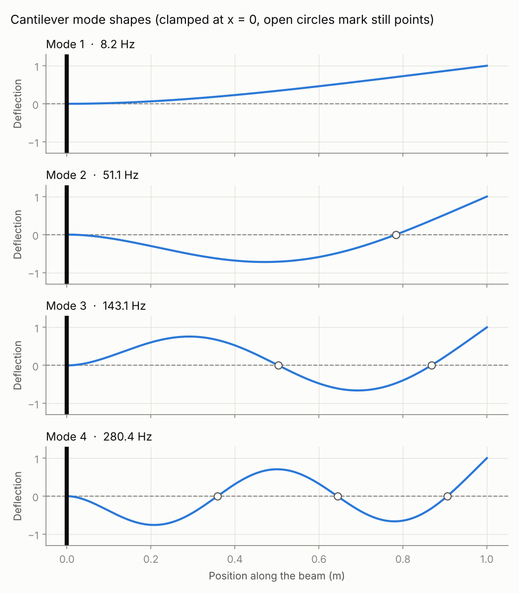
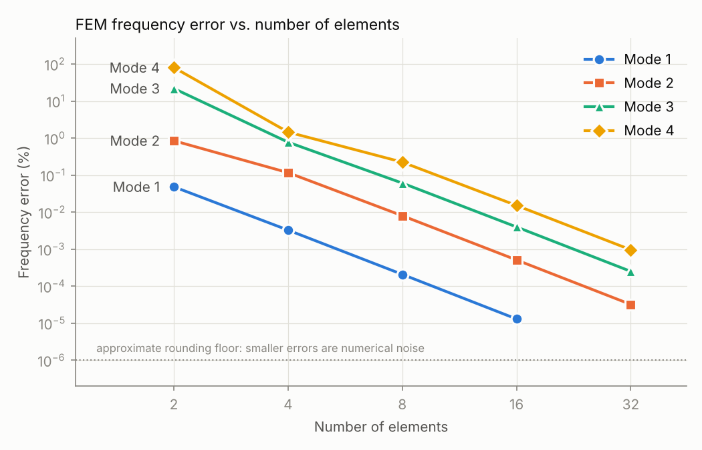
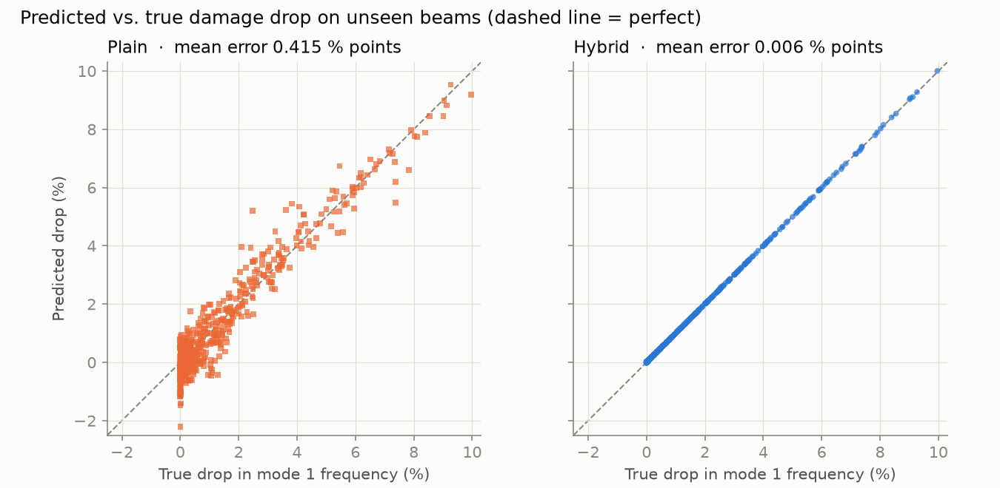
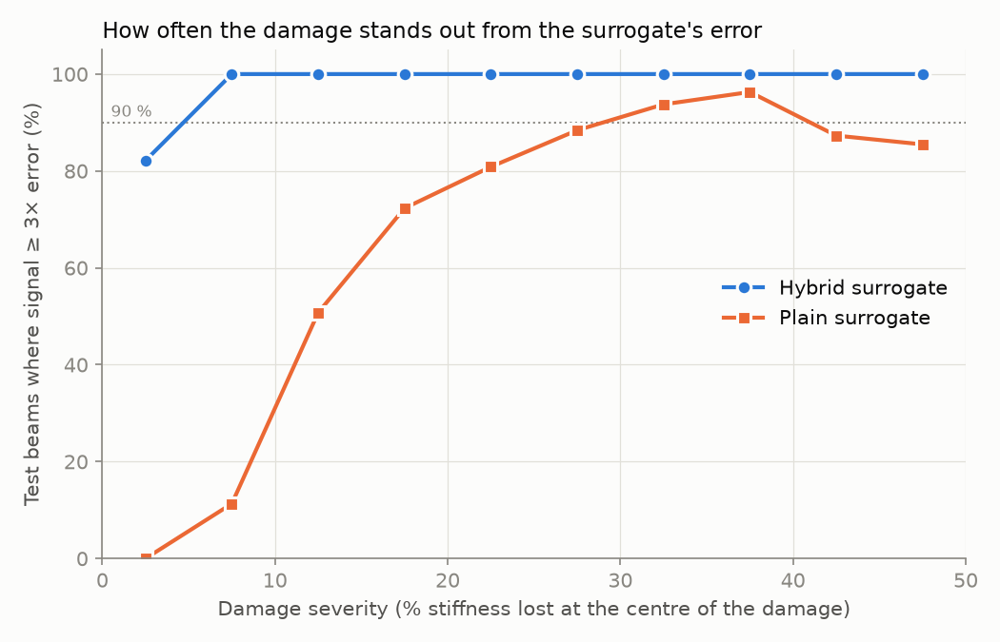

# BeamTwin

**An FEM-based digital twin for vibration-based damage detection in beam structures**

BeamTwin combines a finite element model of a beam, written from scratch, with
machine learning. The finite element model predicts how the beam bends and
vibrates. A neural surrogate learns to give the same answers in milliseconds,
and a damage detector works backwards from vibration readings to locate and size
stiffness loss.

> Status: work in progress. Steps 1-3 (FEM, modal analysis, neural surrogate) are complete and validated.



## Roadmap

| Step | What it does | Status |
|---|---|---|
| 1. FEM solver | Euler-Bernoulli beam elements, assembly, cantilever solution | Done |
| 2. Modal analysis | Natural frequencies and mode shapes | Done |
| 3. Neural surrogate | Fast network trained on FEM results | Done |
| 4. Damage detection | Locate and size stiffness loss from vibration data | Planned |
| 5. Deployment | FastAPI back end, web app, Docker | Planned |
| 6. Real-data validation | Test on measured data (Los Alamos frame) | Planned |

## Validation so far

For a steel cantilever (1 m long, 50 x 10 mm section, 10 N tip load):

| Quantity | FEM | Textbook | Formula |
|---|---|---|---|
| Tip deflection | 4.000 mm | 4.000 mm | PL³ / 3EI |
| Tip rotation | 0.006 rad | 0.006 rad | PL² / 2EI |

The FEM result matches the textbook to rounding error for any number of
elements, because the cubic shape functions contain the exact solution for a
tip load.

Natural frequencies of the same beam (32 elements):

| Mode | FEM (Hz) | Textbook (Hz) | Error |
|---|---|---|---|
| 1 | 8.154 | 8.154 | < 0.0001% |
| 2 | 51.099 | 51.099 | < 0.0001% |
| 3 | 143.079 | 143.079 | 0.0003% |
| 4 | 280.380 | 280.377 | 0.0010% |

Error falls steadily as elements are added, at the rate expected for cubic beam elements:



See [docs/theory.md](docs/theory.md) for derivations, and
[notebooks/01_modal_analysis.ipynb](notebooks/01_modal_analysis.ipynb) for the worked analysis.

## Neural surrogate (Step 3)

A neural network replaces the FEM for damaged beams (7 inputs: geometry, material, damage
location and severity; 40 outputs: four natural frequencies and four mode shapes at nine
sensor points). Two designs were trained with identical networks, data and settings:

- **Plain**: the network learns everything from all 7 inputs.
- **Hybrid**: the exact cantilever formula gives the healthy frequencies, and the network
  learns only the damage-induced ratio from the 2 damage inputs. Dimensional analysis shows
  that size and material cancel out of this ratio.

Test-set results (600 unseen beams; damage lowers frequencies by about 1.5 % on average):

| | Plain | Hybrid |
|---|---|---|
| Frequency error, mean | 0.38 – 0.42 % | 0.006 – 0.008 % |
| Frequency error, worst | 2.1 – 2.8 % | 0.04 – 0.06 % |
| Damage-drop error | 0.37 – 0.42 % points | 0.006 – 0.008 % points |
| Signal-to-error ratio | 3 – 4 | 190 – 240 |

Building the physics into the model cut the error by about 55× and made the damage
signal about 200× larger than the model error:





Details, training curves and a speed benchmark are in
[notebooks/02_surrogate_evaluation.ipynb](notebooks/02_surrogate_evaluation.ipynb).

## Project layout

```
src/beamtwin/
    fem/          finite element core (Steps 1-2)
    surrogate/    neural surrogate (Step 3)
    damage/       damage simulation and detection (Step 4)
    validation/   comparison with measured data
api/              FastAPI back end (Step 5)
app/              web front end (Step 5)
tests/            automated checks, run on every commit
notebooks/        worked analyses with plots (01: modal analysis, 02: surrogate)
docs/             theory and figures
```

## Getting started

```bash
python -m venv .venv
# Windows:      .venv\Scripts\activate
# macOS/Linux:  source .venv/bin/activate
pip install -e ".[dev,ml]"
pytest -v
```

Example:

```python
from beamtwin.fem import solve_cantilever

u = solve_cantilever(E=200e9, I=4.1667e-9, length=1.0, n_elements=8, tip_load=-10.0)
print("Tip deflection (m):", u[-2])

from beamtwin.fem import cantilever_modes

freqs, shapes = cantilever_modes(E=200e9, I=4.1667e-9, rho=7850, A=5e-4,
                                 length=1.0, n_elements=16, n_modes=4)
print("Natural frequencies (Hz):", freqs)
```

## Limitations

- Linear, small-deflection Euler-Bernoulli beam theory (no shear deformation).
- Uniform beams only, so far.
- Damage is modelled as a single smooth stiffness loss of fixed width; real
  cracks can differ in shape, and several can occur at once.
- The surrogate is only valid inside the sampled ranges (0.5–2 m long, metals,
  severity up to 50 %). Outside them its predictions are extrapolations.
- All results so far use simulated data. Validation on measured data is a
  planned later stage.

## License

MIT
